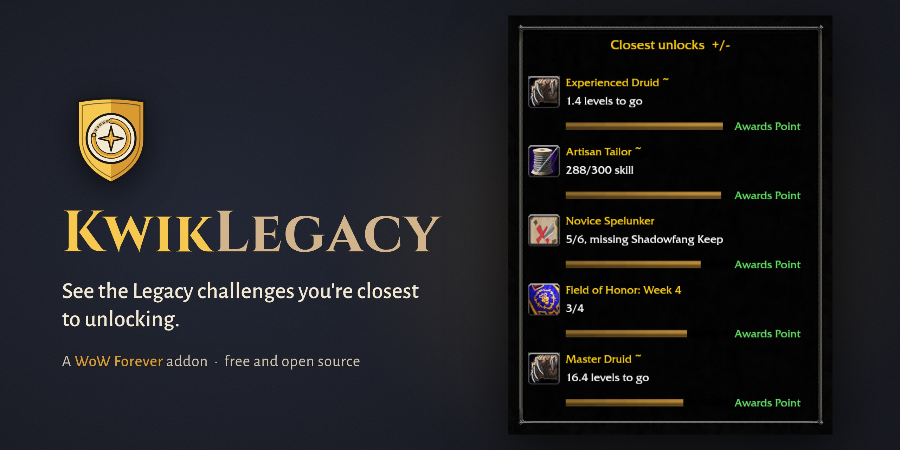
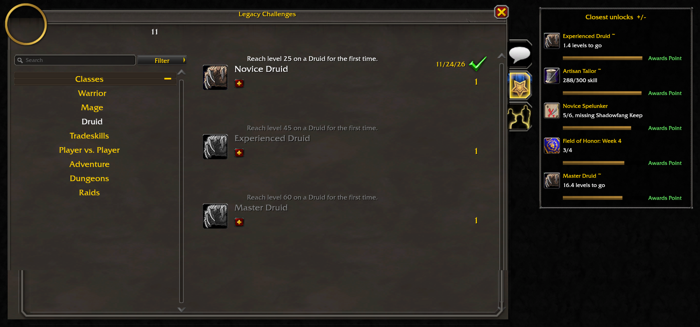
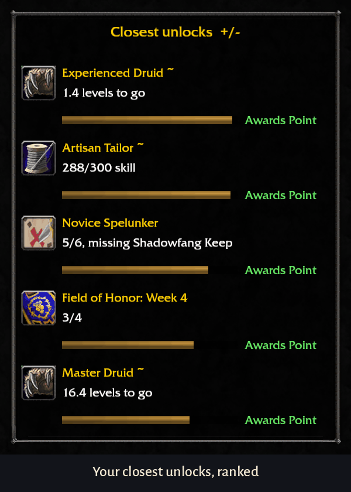
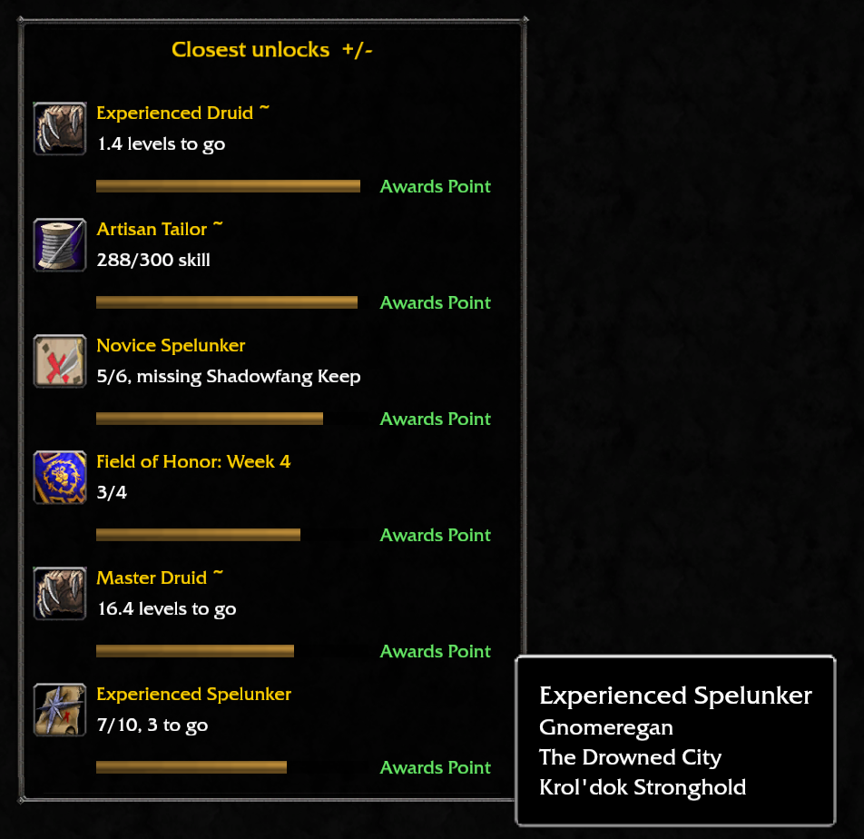
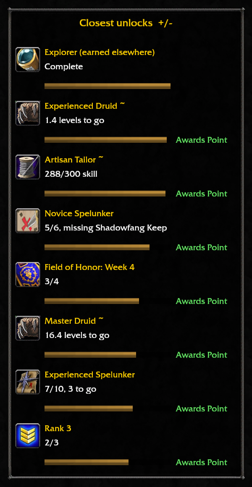

# KwikLegacy



A World of Warcraft: Forever addon that adds a **Closest unlocks** panel to the Legacy System window. It ranks the Legacy challenges you're closest to finishing on your current character and shows what's left on each one.

> **Public alpha.** KwikLegacy is built against Blizzard's Forever UI source and is tested offline with simulated game data. It hasn't been checked against every challenge on a live client yet, so some progress may show as unknown or be estimated. Please [report anything that looks wrong](https://github.com/postblink/KwikLegacy/issues).

## What it shows

Open the Legacy System window, or type `/kl`. The panel docks to the right of the window and lists your nearest unlocks:



As you progress, the list re-ranks itself. Skill-ups move a profession up, and a finished challenge drops off:

<p align="center"></p>

Each row has a progress bar and its remaining steps, for example "5/6, missing Shadowfang Keep", "288/300 skill (train next rank)" or "1.4 levels to go". **Awards Point** marks challenges that would give you a new Legacy Point. Hover over a row to see every missing criterion, or click it to open that challenge in Blizzard's panel. Click the panel heading to collapse or expand it.

How the list is ordered:

- Closest to complete comes first. Ties go to the challenge with fewer steps left.
- Challenges whose progress can't be measured go last. They're never shown as 0%.
- Hidden by default: challenges at 0%, and challenges already completed on another character. Legacy Points are account-wide, so finishing those again doesn't award anything. Challenges this character has already earned never appear.
- A `~` after a name means the progress is a live estimate from your character's level or profession skill, because the game doesn't report a number for that challenge.

| Hover for every missing criterion | `/kl earned` and `/kl rows 8` |
| --- | --- |
|  |  |

The screenshots and animation are rendered with [wow-ui-sim](https://github.com/Osso/wow-ui-sim), a WoW UI simulator. It runs Blizzard's Forever interface from a local client, and here it also runs KwikLegacy's unmodified code. The character and its progress are synthetic, so these aren't captures from a live game. To render them again, see [`media/src/showcase`](media/src/showcase/render.sh).

## Install

Download the latest zip from [Releases](https://github.com/postblink/KwikLegacy/releases). Extract the `KwikLegacy` folder into:

```
World of Warcraft/_forever_/Interface/AddOns/
```

Then restart the game. A `/reload` is enough only if the `KwikLegacy` folder was already there when the game started.

## Commands

| Command | Effect |
| --- | --- |
| `/kl` | Open the Legacy System window with the panel. |
| `/kl earned` | Show or hide challenges completed on another character. |
| `/kl zero` | Show or hide challenges with no progress. |
| `/kl rows <1-8>` | Set how many rows to show (default 5). |
| `/kl status` | Print load and hook state, for bug reports. |
| `/kl dump` | Save a raw snapshot of the challenge data, for bug reports. |

`/kwiklegacy` works as a longer alias for `/kl`. Settings are saved per account in `KwikLegacyDB`.

## Reporting a bug

1. Open the Legacy System window.
2. Type `/kl status` and copy the line it prints.
3. Type `/kl dump`, then `/reload`.
4. Open an issue with the status line and a description of what looked wrong. If asked, attach `WTF/Account/<account>/SavedVariables/KwikLegacy.lua`. It contains your character's class, level, skill lines and challenge progress, so check it before sharing.

## How it works

Legacy challenges are achievements under the hood. KwikLegacy reads them through the standard achievement API, the same way Blizzard's `Blizzard_LegacySystem` does, and calculates progress from each challenge's criteria:

- A challenge with several criteria, such as a dungeon group, counts completed criteria out of the total.
- A criterion with a progress bar uses its own quantity and requirement.
- When the criteria carry no number, class level and profession skill challenges fall back to your live level and skill. Anything else is listed as unknown.

The addon only attaches to Blizzard's panel with read-only hooks. It doesn't change Blizzard's tabs, pages, talent tree or gamepad navigation, and it only recalculates while the panel is visible, at most twice a second.

Current limits:

- Threshold detection for level and skill challenges reads English challenge text. Other locales may show those challenges as unknown.
- Profession matching uses the skill-line ID first, then the visible profession name. Collapsed skill headers can hide a profession from the name fallback.

## Development

The tests run offline with Lua 5.1, simulated game APIs and mock frames:

```sh
lua5.1 tests/model.lua
lua5.1 tests/load_smoke.lua
lua5.1 tests/load_smoke.lua already
python3 tests/mutations.py
for f in ./*.lua ./tests/*.lua; do luac5.1 -p "$f" || exit 1; done
luacheck --no-color .
```

The smoke harness loads every file in the `.toc` and exercises both load orders (Blizzard's Legacy UI loaded before and after this addon). It also covers row clicks, filtering, live estimates, tooltips, refresh throttling, collapse state, slash commands and the diagnostic snapshot. `tests/mutations.py` breaks each ranking and filter rule in a disposable copy to confirm the tests catch it. None of this simulates the real game engine or proves taint safety.

The design was checked against Blizzard's Forever UI source ([Gethe/wow-ui-source](https://github.com/Gethe/wow-ui-source), `forever` branch, build 71037) and a generated [API reference](https://atraeau.github.io/WoW-Addons/api.json) for interface 16001.

### Media

Everything in `media/` is generated from sources in `media/src`:

- `python3 media/src/make_icon.py` writes the icon and transparent mark as SVG.
- `media/src/showcase/render.sh` renders the screenshots and the demo GIF in wow-ui-sim. It needs `WOW_DIR` (a WoW Forever install, mounted read-only) and `SIM_DIR` (the simulator's Forever release).
- To build the banner, render `media/src/banner.html` with headless Chromium. The command is in the file's header.

## License

KwikLegacy is licensed under [GPL-3.0-or-later](LICENSE). The banner fonts in `media/src/fonts` are Cinzel and Alegreya Sans, both under the SIL Open Font License. Their license texts are in the same folder.
