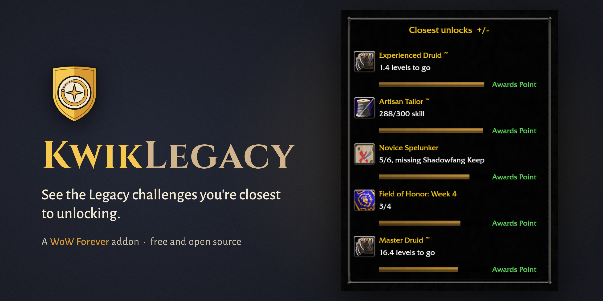
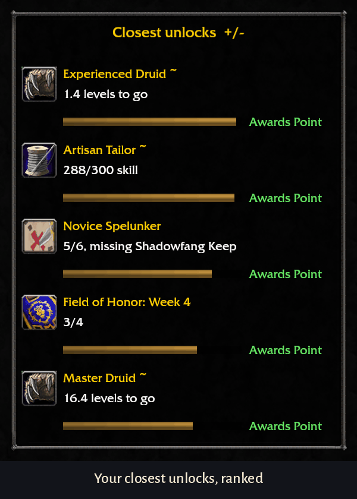

# Distribution page copy

Copy for CurseForge, Wago and WoWInterface listings. Use the images from `media/`, and keep the alpha note until the live-client check is done.

## Summary

Shows the Legacy challenges you're closest to unlocking, right beside the Legacy System window.

Under 100 characters, for CurseForge's project summary field.

## Project avatar

`media/kwiklegacy-icon-512.png` (square, 512 × 512). The vector source is `media/kwiklegacy-icon.svg`.

## Description (Markdown)

**KwikLegacy** adds a **Closest unlocks** panel to WoW Forever's Legacy System window. It ranks the Legacy challenges your current character is closest to finishing and tells you exactly what's left:

- **5/6, missing Shadowfang Keep:** dungeon groups list the dungeons you still need.
- **288/300 skill (train next rank):** profession challenges track your live skill and remind you when you need the next trainer rank.
- **1.4 levels to go:** class challenges count down from your current level and XP.

Challenges that would give you a new Legacy Point say **Awards Point**. Hover over a row to see every missing criterion, or click it to jump to that challenge in Blizzard's panel.

### How it ranks

- Closest to complete first. Ties go to the challenge with fewer steps left.
- Challenges at 0% and challenges finished on another character are hidden by default. Legacy Points are account-wide, so those don't award anything new.
- Challenges whose progress can't be measured go last. They're never shown as 0%.

### Commands

- `/kl`: open the Legacy window with the panel
- `/kl earned`: show or hide challenges completed on another character
- `/kl zero`: show or hide challenges with no progress
- `/kl rows <1-8>`: set how many rows to show
- `/kl status` and `/kl dump`: diagnostics for bug reports

### Light by design

KwikLegacy attaches to Blizzard's panel with read-only hooks and doesn't replace or restyle it, so it works alongside UI skins. It only recalculates while the panel is open, at most twice a second. It has no dependencies or libraries.

### Public alpha

KwikLegacy was built against Blizzard's Forever UI source, tested offline and rendered in a UI simulator. It hasn't been verified against every challenge on a live client yet. Please report anything that looks off on [GitHub](https://github.com/postblink/KwikLegacy/issues).

Free and open source under GPL-3.0-or-later.

## Screenshots to upload

| File | Caption |
| --- | --- |
| `media/screenshots/overview.png` | The Closest unlocks panel beside Blizzard's Legacy Challenges window |
| `media/screenshots/panel.png` | Your five closest unlocks, with what's left on each |
| `media/screenshots/tooltip.png` | Hover over a row for every missing criterion |
| `media/screenshots/earned-elsewhere.png` | `/kl earned` and `/kl rows 8`: challenges finished on another character, marked as earned elsewhere |

These images come from wow-ui-sim with Blizzard's Forever UI and synthetic progress, not from live play. If a site asks whether they're gameplay screenshots, describe them as UI renders.

## GitHub social preview

`media/social-preview.png` (1280 × 640). Upload it under the repository's Settings → General → Social preview. GitHub has no API for this.
